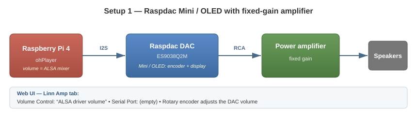
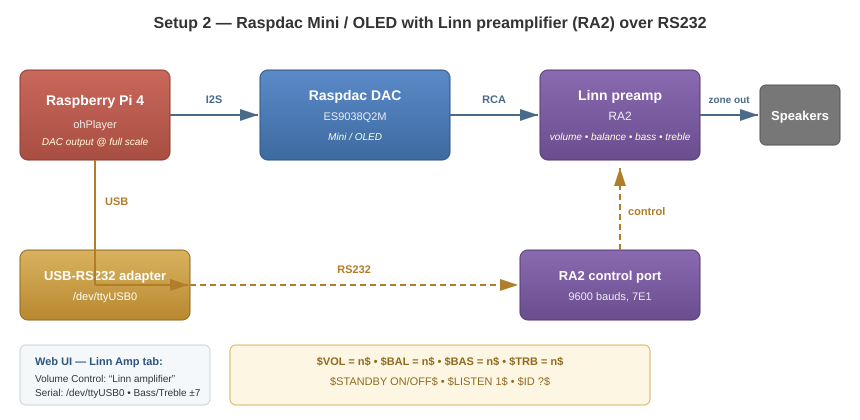

# Description

Forked from the main branch to include support for the Audiophonics Raspdac Mini interface.

A couple of additional scripts are needed. Message me if interested.

# History

* **2026-10-27** — Radio presets, advanced pipeline buffer tuning, radio pinning without TuneIn, build and web ui fixes.
  * Radio presets are now configurable in the web ui (Radio tab): 10 slots, each with a Name, a stream URL and an optional station logo (artwork) URL. Defaults: 6 Radio France stations (hifi AAC icecast) and 4 RNE Spanish national stations (HLS). Edits apply without a reboot.
  * Radio presets and arbitrary stream URLs can be pinned from control point apps without a TuneIn partner id (RadioPins/UrlPins registered unconditionally).
  * Advanced pipeline buffer parameters exposed in the web ui (Device tab, Advanced) in pipeline-native units: `Pipeline.StarvationRamperMinSize` (jiffies, default 5644800 = 100 ms) and `Pipeline.EncodedReservoirSize` (bytes, default 1572864 = the ohPipeline default). Useful to absorb network jitter on unstable links.
  * `fetch_deps.sh` also fetches the `Generated/` ohNet headers (Cp*/Dv*) from the openhome/ohNetGenerated GitHub tag matching the configured version.
  * Fixed a ConfigUi crash on open after a store reset: the web ui message pool was exhausted by the burst of field notifications (pool raised to 200 messages / 300 x 64-byte buffers).
  * Quiet debug logging: the `kPipeline` and `kMedia` modules (one line per HLS segment / pipeline transition) are disabled by default.

* **2026-10-23** — Volume routing with official DS semantics, mixer-less sound cards, mDNS crash fix, install and build fixes.
  * `Internal Volume Control` (`Volume.Enabled`) exposed in the web ui (Volume tab): `Yes`/unset — internal ALSA volume; `No` with a serial port configured — external Linn amplifier over RS232; card without a mixer or amplifier not detected — volume greyed out in control points. The `LinnAmp.VolumeControl` parameter was removed.
  * New `LinnAmp.AlsaVolume` parameter (0-100, default 100) to level-match rooms when the Linn amplifier handles volume.
  * `StoreWithOverriddenValue` decouples the user's persisted intent from what the MediaPlayer sees at runtime.
  * Sound cards without a mixer are fully supported (no crash, no error spam).
  * mDNS host name is now derived from the Linux host name (`ohp-<hostname>`), fixing the sporadic `-65548` name-conflict crash between players.
  * Makefile: `install` target fixed (web ui resources to `/usr/share/openhome-player/res/`, `webconfig.js`, `lang/`), incremental `VersionInfo.h` generation.

* **2026-10-18** — Added external Linn Roomamp 2 support.
* **2026-09-04** — Synced back with AndreHro updates. Currently only used on `aarch64`, but it can easily be adapted to `armhf` if needed. Please raise an issue if support is required.

* **2025-04-19** — As `ohPlayer` is no longer maintained or aligned with the rest of the stack, the project was redesigned based on `ohPipeline/TestMediaPlayer`.

  Some build details can be found here:
  [ohContainerBuilder](https://github.com/jchassin/ohContainerBuilder)

  It can be built in an Ubuntu container or directly on a Raspberry Pi. Open a ticket if support is needed.

* **2021-10-16** — Added support for the Audiophonics Raspdac Mini LCD:
  [Audiophonics Raspdac Mini LCD Kit](https://www.audiophonics.fr/fr/lecteurs-reseau-open-source/audiophonics-raspdac-mini-lcd-kit-diy-lecteur-reseau-pour-raspberry-pi-4-dac-es9038q2m-p-15148.html)

  Initial fork added support for the Audiophonics Raspdac Mini OLED screen.

Based on the [OpenHome Sample Players](https://github.com/openhome/ohPlayer) for macOS, Windows, Linux and Raspberry Pi.

---

# Radio Presets

The Radio source exposes 10 presets, fully configurable in the web configuration ui (Radio tab). Each preset has:

* **Name** — station title shown in control point apps
* **URL** — stream address (icecast/aac, HLS m3u8, ...)
* **Image URL** — optional station logo, shown as preset artwork

Presets with an empty name or URL are unset. Changes take effect without a reboot.

Defaults: the six Radio France hifi AAC stations (France Inter, FIP, France Musique, France Info, France Culture, Mouv') and four RNE Spanish national stations (Radio Nacional, Radio Clasica, Radio 3, Radio 5, HLS streams). Values already saved in the store always override the defaults.

Presets can be pinned from control point apps; pins reference the preset number.

# Hardware Setups

Two hardware configurations are supported, selected through the web configuration UI (presentation URL of the renderer, `Linn Amp` tab):

Hardware references:

* [Audiophonics Raspdac Mini LCD Kit](https://www.audiophonics.fr/fr/lecteurs-reseau-open-source/audiophonics-raspdac-mini-lcd-kit-diy-lecteur-reseau-pour-raspberry-pi-4-dac-es9038q2m-p-15148.html)
* [Audiophonics DAC I-Sabre ES9038Q2M](https://www.audiophonics.fr/fr/modules-dac-et-interfaces/audiophonics-dac-i-sabre-es9038q2m-raspberry-pi-i2s-spdif-pcm-dsd-alimentation-usb-c-p-12795.html) — tested with the ES9028 version, which has since been replaced by this one.

## 1. Raspdac Mini / OLED with fixed-gain amplifier

The simplest setup: the Raspdac Mini (LCD or OLED version) is connected to a power amplifier with fixed gain, and volume is controlled by the ALSA driver of the DAC.

* Volume control: **internal (ALSA driver)** — `Internal Volume Control = Yes`
* The Raspdac rotary encoder adjusts the ALSA volume of the DAC
* No serial connection required



Web UI settings (`Volume` and `Linn Amp` tabs):

| Setting | Value |
|---|---|
| Internal Volume Control | `Yes` |
| Serial Port | *(empty)* |

## 2. Raspdac Mini / OLED with Linn preamplifier (RA2) over RS232

The Raspdac is connected to a Linn preamplifier (e.g. Akurate Kontrol / RA2) through a USB-to-RS232 adapter. The preamp handles volume, balance, bass and treble; the DAC outputs at full scale.

* Volume control: **external Linn amplifier** — `Internal Volume Control = No` with a serial port configured
* Serial port: e.g. **`/dev/ttyUSB0`** (USB-RS232 adapter, 9600 bauds, 7E1)
* Bass / Treble: -7 to +7, applied to the preamp at startup
* Standby: the on/off button of the control point app drives the preamp standby (`$STANDBY ON/OFF$`)
* The ALSA output is set to full scale; attenuation is delegated to the preamp
* Volume is limited by the `Volume.Limit` setting (as on a Linn DSM)



Web UI settings (`Volume` and `Linn Amp` tabs):

| Setting | Value |
|---|---|
| Internal Volume Control | `No` (read-only while the amplifier is active) |
| Serial Port | `/dev/ttyUSB0` |
| Bass / Treble | -7 .. +7 |
| ALSA Volume | 0 .. 100 (output level of the DAC; attenuation handled by the preamp) |
| Detected Amplifier | `LR2` + serial (read-only, from `$ID ?$`) |

Behaviour:
* The DAC output is set to full scale; attenuation is handled by the preamp
* Volume is limited by the `Volume.Limit` setting (as on a Linn DSM)
* The standby button of the control point app drives the preamp standby

Settings are persistent and applied at the next start of the service (a reboot of the renderer, not of the Raspberry Pi, is enough: use the `Reboot` button of the web UI).

---

# Installation

## Prerequisites

Applicable to:

* `aarch64` target running Raspberry Pi OS (tested on Trixie)
* Required packages:

  * `build-essential`
  * `clang`
  * `libglib2.0-dev`
  * `libssl-dev`
  * `libasound2-dev`

Install the required packages with:

```bash
sudo apt update
sudo apt install build-essential clang libglib2.0-dev libssl-dev libasound2-dev
```

## Build

```bash
git clone https://github.com/jchassin/ohPlayer
cd ohPlayer
./fetch_deps.sh
cd linux
make
```

## Rebuild with the full OpenHome stack

For rebuilding with the full OpenHome stack (`ohNet`, etc.), see:

[ohContainerBuilder](https://github.com/jchassin/ohContainerBuilder)

## Deprecated

An Ansible playbook was created for non-Linn users (users without an account in the Linn domain):

[ohPlayer on Ansible Galaxy](https://galaxy.ansible.com/jchassin/ohplayer)
