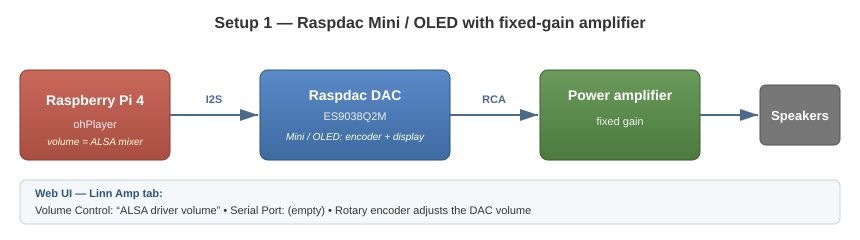
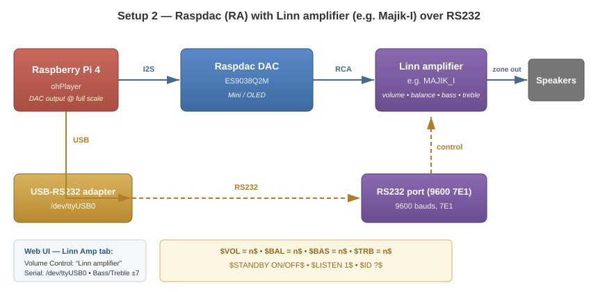

# Hardware Setups

Two hardware configurations are supported, selected through the web configuration UI (presentation URL of the renderer, `Linn Amp` tab):

Hardware references:

* [Audiophonics Raspdac Mini LCD Kit](https://www.audiophonics.fr/fr/lecteurs-reseau-open-source/audiophonics-raspdac-mini-lcd-kit-diy-lecteur-reseau-pour-raspberry-pi-4-dac-es9038q2m-p-15148.html)
* [Audiophonics DAC I-Sabre ES9038Q2M](https://www.audiophonics.fr/fr/modules-dac-et-interfaces/audiophonics-dac-i-sabre-es9038q2m-raspberry-pi-i2s-spdif-pcm-dsd-alimentation-usb-c-p-12795.html) — tested with the ES9028 version, which has since been replaced by this one.
* [Linn RS232 specification (LR2)](https://docs.linn.co.uk/wiki/images/2/2d/LR2_RS232_Specification.pdf) — the serial protocol spoken to the Linn preamplifier (volume, bass/treble, standby, `$ID ?$`)
* [Majik Kontrol RS232 specification](https://docs.linn.co.uk/wiki/images/6/64/Majik_Kontrol_RS232_Specification.pdf) — same `$...$` protocol for Majik products: `VOLUME` instead of `VOL`, `BALANCE`, `INPUT AUDIO`, `ID` returns the model name (e.g. `MAJIK_I`), `VERSION HARDWARE/SOFTWARE ?`
* [Linn RS232 cables](https://docs.linn.co.uk/wiki/images/1/13/RS232_Cables_v102.pdf) — cabling reference for the USB-to-RS232 adapter

## 1. Raspdac Mini / OLED with fixed-gain amplifier

The simplest setup: the Raspdac Mini (LCD or OLED version) is connected to a power amplifier with fixed gain, and volume is controlled by the ALSA driver of the DAC.

* Volume control: **internal (ALSA driver)** — `Internal Volume Control = Yes`
* The Raspdac rotary encoder adjusts the ALSA volume of the DAC
* No serial connection required

Web UI settings (`Volume` and `Linn Amp` tabs):

| Setting | Value |
|---|---|
| Internal Volume Control | `Yes` |
| Serial Port | *(empty)* |

## 2. Raspdac Mini / OLED (RA) with a Linn amplifier over RS232 — e.g. Linn Majik-I (`MAJIK_I`)

The Raspdac (RA) is connected to a Linn amplifier through a USB-to-RS232 adapter. The amplifier handles volume and balance; the DAC outputs at full scale. Two families of Linn amplifiers are detected, both speaking the same `$...$` RS232 protocol at 9600 bauds, 7E1:

* **LR2 preamplifiers** (e.g. Akurate Kontrol / RA2): commands `VOL`/`BAL`/`BAS`/`TRB`/`LISTEN`; `$ID ?$` returns a model code + 12-digit serial (`LR2...`); bass/treble -7 to +7 applied at startup.
* **Majik integrated amplifiers** (e.g. Majik-I): commands `VOLUME`/`BALANCE`/`INPUT AUDIO` (no bass/treble); `$ID ?$` returns the model name (`MAJIK_I`).

The command dialect is probed automatically at startup (`VOLUME ?` vs `VOL ?`), so any Linn amplifier using this protocol is detected.

### Example: RA + Majik-I (`MAJIK_I`)

* Detected Amplifier: `MAJIK_I` (no serial — `$ID ?$` returns the model name); HW/SW versions from `$VERSION HARDWARE ?$` / `$VERSION SOFTWARE ?$` (the HW answer is one final line per board: MAIN / DISPLAY / PHONO — all shown)
* Volume `$VOLUME = n$` / query `$VOLUME ?$` (0-100), balance `$BALANCE = n$`, input `$INPUT AUDIO INPUTn$` (see `Amplifier Input`, default 1); **no bass/treble commands** on a Majik
* Standby `$STANDBY ON/OFF$`: the Majik-I answers power commands slowly (up to several seconds) — the renderer allows 3 attempts × 3 s and does not resend a standby command already applied
* Volume/balance set commands are sent fire-and-forget (no wait for the answer), so slider-driven ramps stay smooth

* Volume control: **external Linn amplifier** — `Internal Volume Control = No` with a serial port configured; the volume stays greyed out if no amplifier answers `$ID ?$`
* Serial port: e.g. **`/dev/ttyUSB0`** (USB-RS232 adapter, 9600 bauds, 7E1)
* Bass / Treble: -7 to +7, applied to the amplifier at startup (LR2 preamplifiers only)
* Standby: the on/off button of the control point app drives the amplifier standby (`$STANDBY ON/OFF$`)
* Volume is limited by the `Volume.Limit` setting (as on a Linn DSM)

Web UI settings (`Volume` and `Linn Amp` tabs):

| Setting | Value |
|---|---|
| Internal Volume Control | `No` (read-only while the amplifier is active) |
| Serial Port | `/dev/ttyUSB0` |
| Bass / Treble | -7 .. +7 |
| ALSA Volume | 0 .. 100 (output level of the DAC; attenuation handled by the amplifier) |
| Amplifier Input | 1 .. 6 (default 1): input of the amplifier the renderer is connected to, selected at startup |
| Detected Amplifier | `LR2` + serial for a preamplifier, model name e.g. `MAJIK_I` for a Majik (read-only, from `$ID ?$`), plus HW/SW versions (from `$VERSION HARDWARE/SOFTWARE ?$`) |

Behaviour:
* The DAC output is set to full scale; attenuation is handled by the amplifier
* Volume is limited by the `Volume.Limit` setting (as on a Linn DSM)
* The standby button of the control point app drives the amplifier standby

Settings are persistent and applied at the next start of the service (a reboot of the renderer, not of the Raspberry Pi, is enough: use the `Reboot` button of the web UI).
